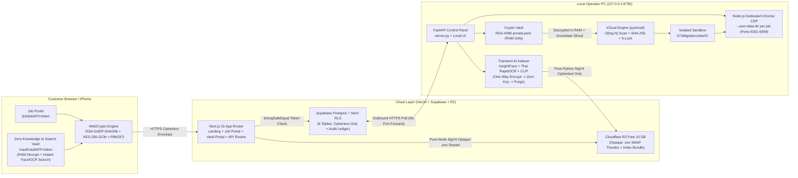

# System Architecture — CloudVault Concierge

> **Topology**: Hybrid Cloud Relay + Local Operator PC Workbench  
> **GitHub & CI/CD**: `https://github.com/teetawat-2580/icloud-photo-image-archive.git` $\rightarrow$ Vercel Project `icloud-photo-image-archive` (`prj_GBsPsqGtEJdVLRxPDZ0JUDuMALRH`, Root Directory: `web`, Node `24.x`)  
> **Cloud Tier**: Vercel (Next.js 15 App Router) + Supabase Free Tier (`zhgyiljmzsjbvlgozpfu`, `ap-southeast-1`)  
> **Local Execution**: Windows Operator PC (`http://127.0.0.1:8790`) + Isolated Staging Root (`D:\MigrationJobs`)

---

## 1. End-to-End Hybrid Architecture



---

## 2. Component Boundaries

| Directory | Runtime | Responsibility | Trust Boundary |
| :--- | :--- | :--- | :--- |
| `web/` | Next.js 15 (Vercel / Node 24) | Public Landing Page (`/`), Customer Job Portal (`/job/[jobId]`), Zero-Knowledge AI Search Vault (`/vault/[vaultId]`), WebCrypto client encryption/decryption, client-side RAM search engine, and token-validated API routes (`/api/jobs/*`, `/api/vaults/*`). | Holds `SUPABASE_SERVICE_ROLE_KEY` and optional R2 SigV4 keys strictly on server routes. Never sees plaintext credentials, Vault Passphrases, or decrypted thumbnails/OCR. |
| `supabase/migrations/` | PostgreSQL 17 (Supabase) | 6 strict-RLS tables (`operator_nodes`, `migration_jobs`, `credential_envelopes`, `otp_challenges`, `job_year_progress`, `search_vaults`). | Zero `anon` read/write policies. Stores only opaque ciphertext and non-sensitive aggregate counters. |
| `workbench/` | Python 3.14 (FastAPI + `pyicloud` + `cryptography`) | Local Control Panel (`127.0.0.1:8790`), local RSA-4096 keypair vault, sandbox confinement, `O(log N)` iCloud downloader, `5-Lock` cleaner, `PDPA Purge` signer, and Transient Zero-Knowledge AI Vault Indexer (`search_vault_indexer.py`, `r2_storage_client.py`, `media_source_adapter.py`). | Highest trust zone — runs strictly on Operator PC (`127.0.0.1`). Zeroes ephemeral vault AES key after One-Way customer public-key wrap and purges plaintext temp media. |
| `workbench/cdp/` | Node.js 24 (`playwright` / CDP) | Per-customer Dedicated Chrome Profile launcher (`9301..9399`), `3-Layer Personal Album Isolation Guard`, `Strict Single-Line Album Menu Isolation`, and Google Photos batch uploader. | Isolated per-job `--user-data-dir`; zero access to operator's personal Chrome profile. |

---

## 3. Per-Customer Isolated Sandbox Layout

```text
D:\MigrationJobs\
└── <job_id>\
    ├── media\
    │   └── <YYYY>\<MM>\IMG_XXXX.HEIC
    ├── manifest\
    │   ├── catalog_index.json
    │   ├── sha256_ledger.json
    │   └── upload_checkpoint.json
    ├── .icloud_session\            # Isolated Apple cookies/tokens for this job only
    ├── chrome_profile\             # Isolated Chrome --user-data-dir (0 Allow prompts)
    └── export\                     # Optional 2-level Year/Month export + HTML Audit Report
```

When `POST /api/operator/jobs/{job_id}/pdpa-purge` runs:
1. Terminates any Chrome process bound to `<job_id>`'s dedicated profile.
2. Recursively deletes `D:\MigrationJobs\<job_id>\` (with path-traversal confinement check).
3. Verifies `0` files and `0` bytes remain on disk.
4. Signs the `pdpa_purge_certificate` payload with `RSA-PSS-SHA256` and persists it to Supabase `migration_jobs`.
